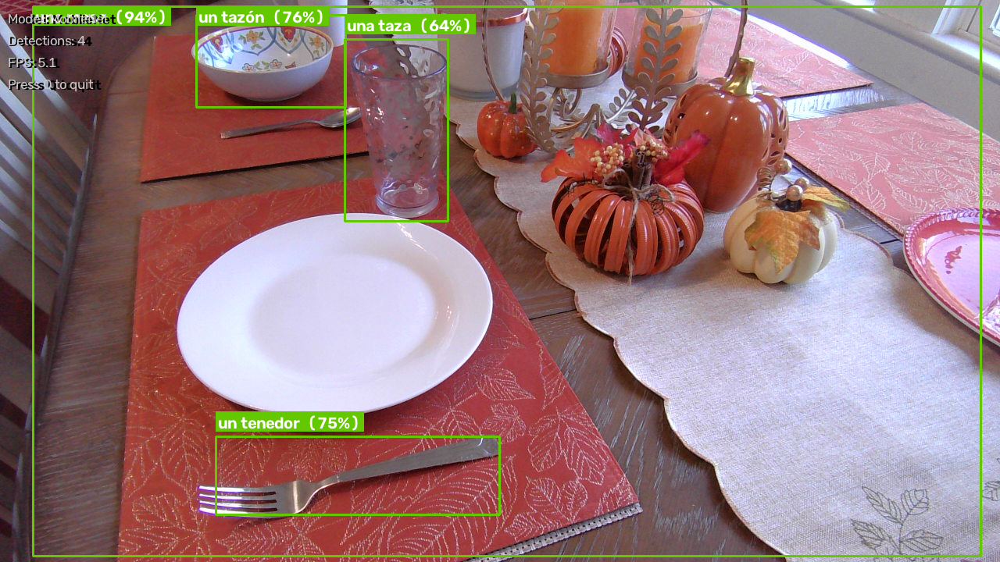
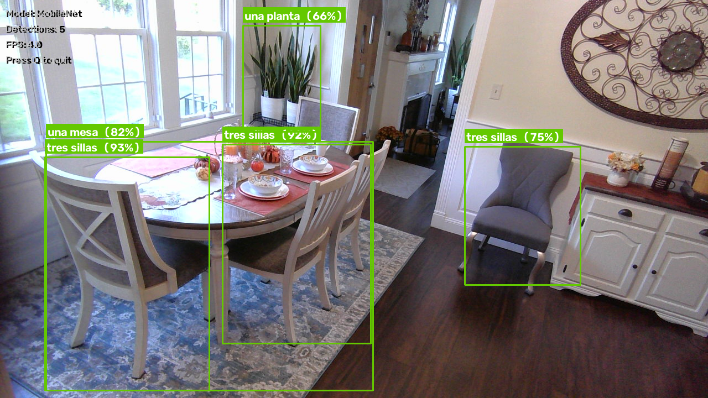
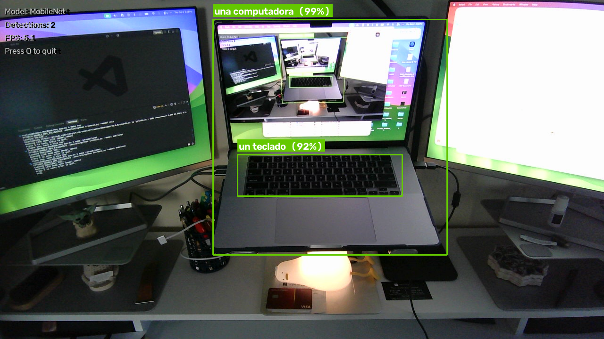
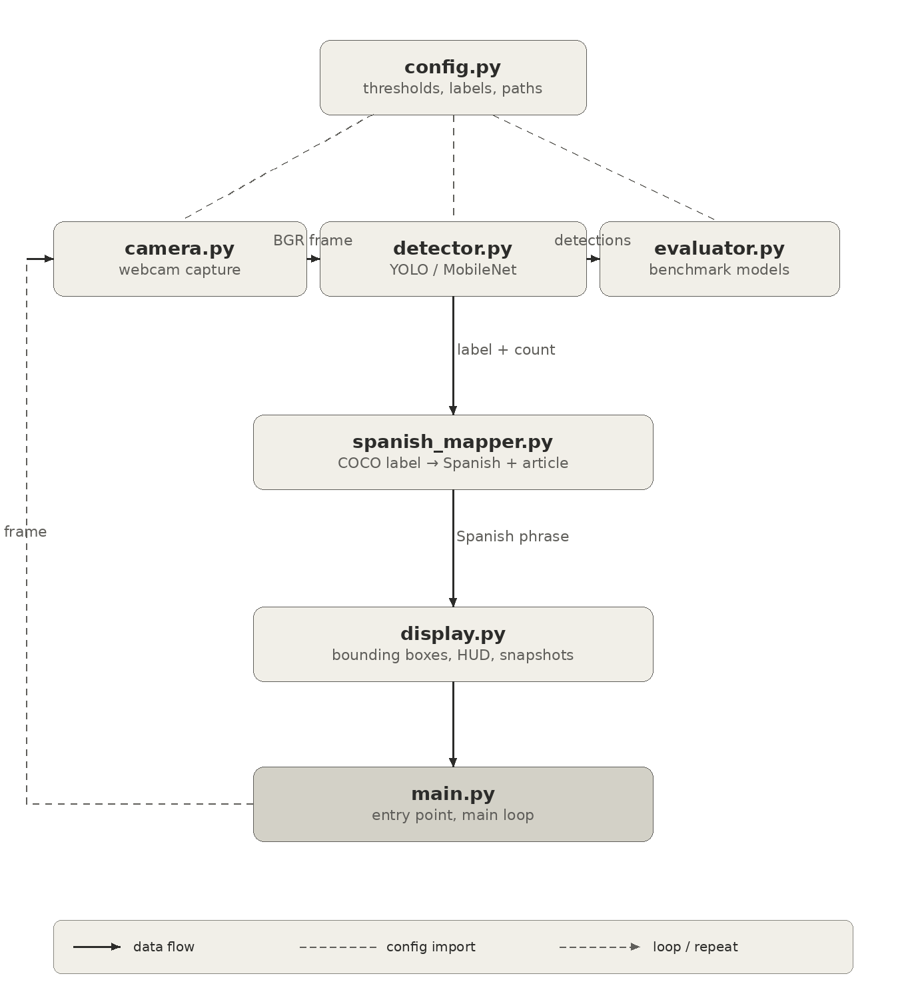

# ¿Qué es? — Real-Time Object Detection for Spanish Vocabulary Learning

**Computer Vision · Deep Learning Inference · Spanish Vocabulary · Python**

**¿Qué es?** (*What is it?*) is a webcam-based computer vision application that detects selected everyday objects and overlays Spanish vocabulary labels. It combines **pretrained object detectors** with a **rule-based Spanish label mapper** that handles grammatical gender and singular/plural forms based on detected object counts.

Created by **Ruben A. Salido** for **CS5330: Pattern Recognition and Computer Vision**, Northeastern University (Spring 2026). The project explores connecting objects in a learner's surroundings with Spanish vocabulary, drawing on the author's background in language education.

**[Watch the original project presentation (15 min)](https://youtu.be/Af26Plr84lI)**

> **Project update — October 2026:** This video documents the original Spring 2026 academic presentation, including limitations encountered at that time. Since recording, the project has been migrated to an Apple Silicon Mac and both YOLOv8 and MobileNet have been verified in live mode. Updated screenshots and a new local benchmark appear below. The original presentation has been preserved rather than rerecorded.


## Demonstration

### Everyday Vocabulary



*MobileNet identifying una mesa (`una mesa`), a bowl (`un tazón`), cup (`una taza`), and fork (`un tenedor`).*

### Multiple Objects and Plural Phrases



*Dining-room detections showing multiple object categories and Spanish plural phrases such as `tres sillas`.*

### Computer Workstation



*Workstation detections including `una computadora` and `un teclado`.*

**[Watch the full project presentation on YouTube](https://youtu.be/Af26Plr84lI)**

The original 15-minute presentation discusses the project's educational motivation, related research, architecture, design decisions, experiments, and initial limitations.

**October 2026 update:** Since the original presentation, the application has been successfully migrated to Apple Silicon. Both YOLOv8 Nano and MobileNet SSD have been verified in live detection and benchmarking modes.


## What the application does

- Captures frames from a webcam with **OpenCV**.
- Runs either **YOLOv8 Nano** (Ultralytics) or **SSDLite320 MobileNetV3-Large** (torchvision) using pretrained weights.
- Filters detections by confidence threshold and a configurable list of **20 supported COCO object categories**.
- Converts detected class labels into manually mapped Spanish nouns, with appropriate singular/plural forms and gender-based articles for singular labels.
- Displays bounding boxes, vocabulary phrases, detection confidence, model name, detection count, and live FPS.
- Saves annotated screenshots with the **S** key.
- Benchmarks both models on the same captured webcam frames, reporting inference time, throughput, detection counts, and average confidence.

**Important distinction:** The object detectors are pretrained neural networks; the Spanish vocabulary and grammar logic is **deterministic**, not a trained NLP model or LLM. The project does not train its own detection model.

## Architecture



The application is organized into small modules:

| Module | Responsibility |
|---|---|
| `src/camera.py` | Webcam opening, reading and safe release |
| `src/detector.py` | Common detector interface and YOLOv8/MobileNet implementations |
| `src/spanish_mapper.py` | COCO class → Spanish singular/plural noun, gender and number phrase |
| `src/display.py` | Bounding boxes, labels, heads-up display and snapshots |
| `src/evaluator.py` | Inference benchmarks and CSV reporting |
| `src/config.py` | Target classes, confidence threshold, webcam and display settings |
| `src/main.py` | Command-line modes and main application loop |

**Live processing:** webcam frame → selected detector → confidence/class filtering → category counts → Spanish label mapping → annotated frame.

**Comparison mode:** capture a shared set of frames → run each model over those frames → summarize metrics. This is a comparison of inference behavior, not a ground-truth detection-accuracy evaluation.

## Spanish vocabulary mapping

The curated vocabulary draws on everyday object terms used in the *Senderos* Spanish textbook. Mappings specify singular and plural nouns and grammatical gender; the program uses indefinite articles by default for singular objects and number words for counts greater than one. The mapper also has definite-article mappings, although live mode does not expose a control to switch article types.

| COCO label | One detected object | Multiple detected objects |
|---|---|---|
| `book` | `un libro` | `dos libros` |
| `chair` | `una silla` | `tres sillas` |
| `couch` | `un sofá` | `dos sofás` |
| `bowl` | `un tazón` | `dos tazones` |
| `potted plant` | `una planta` | `cuatro plantas` |
| `laptop` | `una computadora` | `dos computadoras` |

For multiple instances of the same class, the current display repeats the same count-based phrase on each corresponding detection. Number words are mapped through ten; larger counts use numerals.

## Model comparison — October 2026

Both models were run against **50 captured webcam frames** on an Apple Silicon MacBook Pro, using the application's local benchmark mode.

| Metric | YOLOv8 Nano | MobileNet SSD |
|---|---:|---:|
| Average inference time | 20.45 ms | 181.77 ms |
| Inference throughput* | 48.90 FPS | 5.50 FPS |
| Total detections across frames | 200 | 148 |
| Mean reported detection confidence | 70.2% | 85.3% |

YOLOv8 achieved approximately **8.9× the measured inference throughput** of MobileNet in this particular run. MobileNet's detections had a higher mean reported confidence, **not necessarily higher accuracy**.

*FPS here is computed from average inference time, excluding camera capture and display overhead. Detection counts include repeat sightings of the same objects across frames. This benchmark uses no manually annotated ground truth, so it does **not** establish precision, recall, mAP, or accuracy. Results depend on scene, hardware, device backend and package versions.*

## Requirements and installation

- Python **3.12** (version tested during the migration)
- Desktop system with a usable webcam and graphical OpenCV support
- Internet access on first run to obtain pretrained model weights
- macOS Apple Silicon was tested; other environments may require adaptation

Clone the repository:

```bash
git clone https://github.com/ElGavaOriginal/que-es.git
cd que-es
make install
```

`make install` creates a local `.venv` and installs packages from `requirements.txt`. To install manually:

```bash
python3 -m venv .venv
source .venv/bin/activate
python -m pip install -r requirements.txt
```

YOLOv8 Nano and torchvision model weights are obtained through their respective libraries when needed; weight files are not committed to this repository.

## Run

```bash
make run             # YOLOv8 live detection
make run-mobilenet   # MobileNet live detection
make evaluate        # compare both models on 50 webcam frames
make test            # run the included configuration tests
```

To choose a different benchmark frame count:

```bash
PYTORCH_ENABLE_MPS_FALLBACK=1 .venv/bin/python src/main.py --model compare --frames 100
```

In a live OpenCV window, press **S** to save a snapshot or **Q**/**Esc** to quit. Automatically captured images are saved in `snapshots/`; the default benchmark writes `benchmark_results.csv` in the project root. These generated outputs are ignored by Git.

## Repository layout

```text
que-es/
├── src/
│   ├── camera.py
│   ├── config.py
│   ├── detector.py
│   ├── display.py
│   ├── evaluator.py
│   ├── main.py
│   └── spanish_mapper.py
├── test/
│   └── test_config.py
├── media/
│   ├── screenshots/
│   │   ├── mobilenet-table-closeup.png
│   │   ├── mobilenet-dining-room.png
│   │   └── mobilenet-workstation.png
│   └── diagrams/
│       └── que-es-system-flow.png
├── .gitignore
├── Makefile
├── requirements.txt
└── README.md
```

The diagrams and screenshots listed above should be copied/renamed to these paths before publishing.

## Limitations and possible extensions

- Detection is limited to pretrained COCO classes and the project's 20 selected target labels; unusual objects, lighting and occlusion can cause misses or incorrect predictions.
- Spanish labels come from a fixed vocabulary map, not open-ended visual understanding or contextual language generation.
- The display uses a category-level count for plural phrases, rather than assigning each individual object a unique number.
- The model comparison reports inference metrics and confidence but does not measure accuracy against labeled ground truth.
- A classroom study of learning outcomes was **not** conducted, so the project should be viewed as an exploratory educational prototype rather than a validated teaching intervention.

Potential improvements include expanding the vocabulary, supporting pronunciation and learner interaction, improving language-specific exceptions and regional terminology, and evaluating predictions against an annotated dataset.

## Academic origin and presentation

**Ruben A. Salido** · Northeastern University · CS5330: Pattern Recognition and Computer Vision · Spring 2026

[**Original project presentation: ¿Qué es? (YouTube)**](https://youtu.be/Af26Plr84lI)

The original recording discusses the academic motivation, research context, implementation and initial challenges. **The October 2026 migration and benchmark results above describe the later working version**, not the status of the program when the presentation was recorded.
